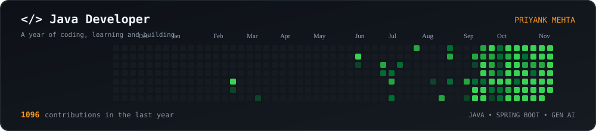

<!-- ===================== HEADER ===================== -->

<div align="center">


<a href="https://port-folio-cyan-one.vercel.app/">

</a>

<br/><br/>

<a href="https://port-folio-cyan-one.vercel.app/">

</a>


</div>

---

## 💫 About Me

```java
public class Priyank {

    private String role = "Java Developer | Gen AI | Forward Deployed Engineer";
    private String learning = "Spring Boot, Spring AI, Kubernetes, Kafka";
    private String motto = "Just for learning... until it becomes a full application.";

    public String askMeAbout() {
        return "Java, Spring Boot, Backend Development";
    }
}
```

- 🔭 Currently exploring **Spring AI, Generative AI (GenAI), and Forward Deployed Engineering (FDE)**, with a focus on building scalable, AI-powered backend applications.
- 🤖 Exploring **Generative AI** and working towards a **Forward Deployed Engineer (FDE)** role.
- 💬 Ask me about **Java, Spring Boot, REST APIs and Microservices**.
- 🌱 Most of my side projects start with *"just for learning"* and end up becoming full applications.
- 🌐 Portfolio: [Priyank Portfolio](https://port-folio-cyan-one.vercel.app/)
- 📫 Reach me at **priyankmehta409@gmail.com**

---

## 🌐 Let's Connect

<div align="center">

<a href="https://port-folio-cyan-one.vercel.app/">

</a>

<a href="https://linkedin.com/in/priyankmehta19">

</a>

<a href="mailto:priyankmehta409@gmail.com">

</a>

<a href="https://github.com/Priyank1922">

</a>

</div>

---

## 🧰 Technical Skills

<div align="center">

### Programming Languages


### Java and Backend Engineering


<br/>


### Generative AI and Data Science


<br/>


### Databases and Storage


### Cloud, DevOps and Deployment


### Frontend and UI/UX Development


### Developer Tools and Creative Software


</div>

---

## 🚀 Featured Projects

### 1. NEXUS AI Agent

**Java | Spring Boot | Spring AI | OpenRouter | LLM Tool Calling**

An AI-powered autonomous agent that understands user queries and executes tools to perform tasks such as calculations, weather information and currency conversion.

- Integrated Spring AI and OpenRouter.
- Implemented LLM-based tool calling.
- Integrated external APIs.
- Developed a responsive web interface.

[GitHub Repository](https://github.com/Priyank1922/AI_Agent) | [Live Demo](https://ai-agent-51f8.onrender.com)

### 2. API Gateway Microservices Platform

**Java | Spring Boot | Spring Cloud | Eureka | MySQL | JWT**

A microservices-based API Gateway platform featuring centralized request routing, authentication and security.

- Integrated multiple backend services.
- Implemented JWT authentication and role-based authorization.
- Added API key validation and rate limiting.
- Integrated Resilience4j and request validation.

[GitHub Repository](https://github.com/Priyank1922/API-Gateway-Microservices-Platform)

### 3. College Management System with Spring AI

**Java | Spring Boot | Spring AI | MySQL**

A college management application combining traditional student management functionality with Generative AI.

- Student CRUD operations.
- Prompt Templates.
- Prompt Stuffing.
- AI-powered college information assistance.

[GitHub Profile](https://github.com/Priyank1922)

### 4. Real-Time Chat Application

**Java | Spring Boot | WebSocket | STOMP | Thymeleaf**

A real-time messaging application supporting room-based communication using WebSocket and STOMP.

- Implemented real-time messaging.
- Integrated WebSocket and STOMP.
- Developed a Thymeleaf-based interface.

[GitHub Profile](https://github.com/Priyank1922)

---

## 📈 GitHub Performance

<div align="center">


</div>

---

## 🔥 Contributions

<div align="center">


<br/><br/>

### 3D GitHub Contribution Calendar

<!-- Generated automatically by profile-3d.yml -->


</div>

---

## ☕ My Contributions &lt;/Java&gt;

```java
// Every contribution represents progress.

for (Day day : contributions.lastYear()) {

    if (day.hasCommits()) {
        developer.code(day);
    }

    developer.keepLearning();
}
```

<div align="center">

### 💻 Java Coding Environment

<!-- Generated by .github/workflows/coding-animation.yml -->



</div>

---

<div align="center">

### 💬 *"Just for learning"... said every full application ever.*


</div>
