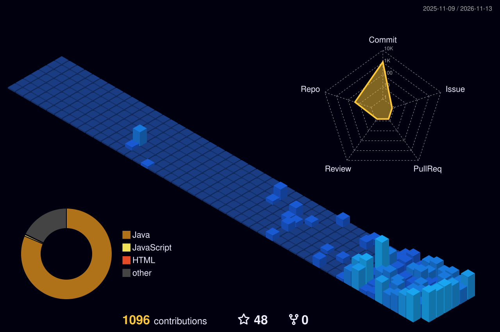

## 🧰 Technical Skills

### Programming Languages

### Java and Backend Engineering

 

### Generative AI and Data Science

 

### Databases and Storage

### Cloud, DevOps and Deployment

### Frontend and UI/UX Development

### Developer Tools and Creative Software

---

## 📈 GitHub Performance

---

## 🔥 Contributions

  

<!-- 3D contribution graph (generated by the GitHub Action — see profile-3d.yml) -->

---

## 🚀 Momentum

